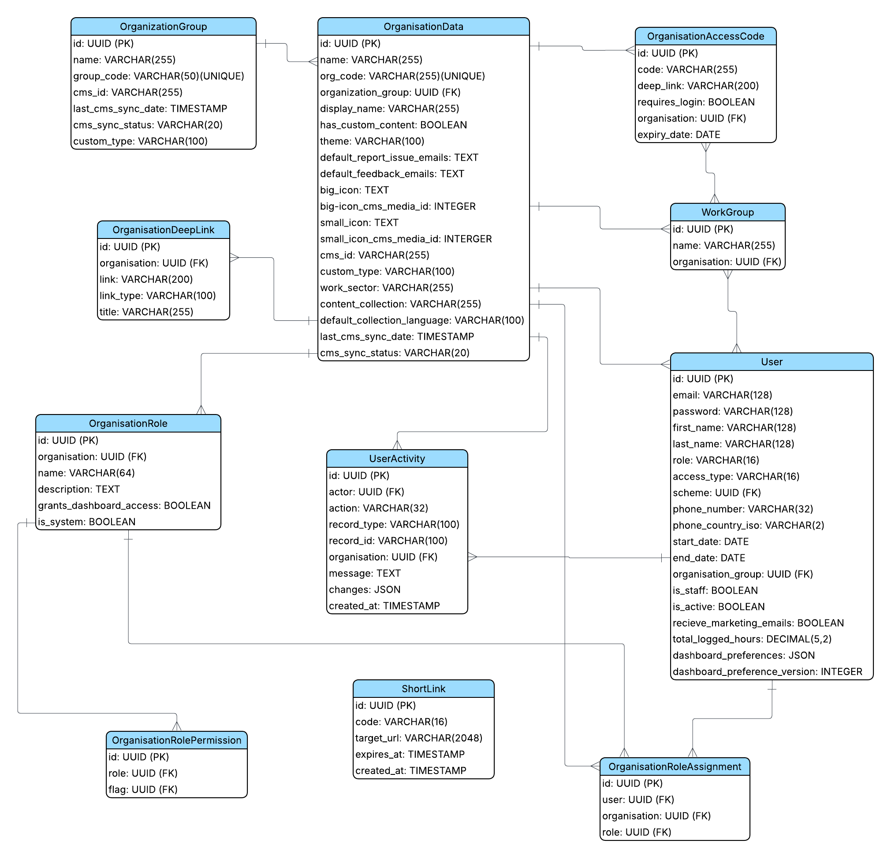

### User Management Entity Relationships

The sections below describe the purpose of each model and its relationships with other models.

#### 1. OrganizationGroup (Organisation Group)

**Database Table:** `preference_organizationgroup`

The `OrganizationGroup` model represents a collection of organisations. It is used to group related organisations together for management at the organisation-group level. For example, a company like **Channel** with multiple branches may create an organisation group to manage all of its branches together.

**Relationships**

An organisation group:

- can contain many organisations
- can have many users

#### 2. OrganisationData (Organisations)

**Database Table:** `preference_organisationdata`

The `OrganisationData` model represents an organisation. It is the central model in the User Management module and stores the organisation's configuration.

**Relationships**

An organisation:

- may belong to one organisation group
- can have many work groups
- can have many roles
- can have many role assignments
- can have many deep links
- can have many activity logs
- can have many access codes
- can be linked to many users

#### 3. OrganisationAccessCode (Work Code)

**Database Table:** `preference_organisationaccesscode`

The `OrganisationAccessCode` model stores access codes for an organisation. These access codes are used in the Just Good Work mobile application to log in and access the organisation's data.

**Relationships**

An organisation access code:

- may belong to one organisation
- can be assigned to multiple work groups

#### 4. WorkGroup (User Group)

**Database Table:** `user_management_workgroup`

The `WorkGroup` model represents a team or department within an organisation.

**Relationships**

A work group:

- belongs to one organisation
- can have multiple access codes
- can have many users

#### 5. OrganisationRole (Role)

**Database Table:** `user_management_organisationrole`

The `OrganisationRole` model defines a role within an organisation. Roles determine the permissions available to users.

**Relationships**

An organisation role:

- belongs to one organisation
- has many role permissions
- has many role assignments

#### 6. OrganisationRolePermission (Permission)

**Database Table:** `user_management_organisationrolepermission`

The `OrganisationRolePermission` model links an organisation role to a feature flag. It defines the permissions assigned to a role.

**Relationships**

An organisation role permission:

- belongs to one organisation role
- belongs to one feature flag

#### 7. OrganisationRoleAssignment

**Database Table:** `user_management_organisationroleassignment`

The `OrganisationRoleAssignment` model assigns an organisation role to a user within a specific organisation.

**Relationships**

An organisation role assignment:

- belongs to one user
- belongs to one organisation
- belongs to one role

#### 8. OrganisationDeepLink (Organisation QR Code)

**Database Table:** `preference_organisationdeeplink`

The `OrganisationDeepLink` model stores deep links for an organisation.

These links allow users to open specific pages or features directly from the mobile application.

**Relationships**

An organisation deep link:

- belongs to one organisation

#### 9. UserActivity (User Activity Logs)

**Database Table:** `user_management_useractivity`

The `UserActivity` model records important actions performed in the User Management module.

These records provide an audit trail and cannot be modified or deleted after they are created.

**Relationships**

A user activity record:

- may reference one organisation
- may reference one user as the actor

#### 10. User

**Database Table:** `users_user`

The `User` model stores information about system users.

**Relationships**

A user:

- can have many activity records
- can be assigned one or more organisation roles through role assignments
- can belong to one organisation group
- can be linked to one or more organisations at the model level
- can belong to many work groups

**Implementation note**

Although `User.organisation_data` is a many-to-many relationship in the schema, current User Management flows only assign one organisation per organisation user at a time. That single-organisation rule is enforced in the application logic, not by the database relationship itself.

#### 11. ShortLink

**Database Table:** `user_management_shortlink`

The `ShortLink` model stores shortened URLs. It generates a unique code that redirects users to a longer target URL. Short links can optionally expire after a specified date and time.

**Relationships**

- This model does not have direct relationships with the other User Management models.
